# 前端页面说明

> 负责人：嵇宇锋　|　状态：**前端页面已接入 develop 后端，8 个页面全部联调通过，13 张运行截图已产出**
> 成果物：`server/src/main/resources/static/` 下 8 个前端文件 + 本说明 + 13 张运行截图。
> 前端页面按 [接口设计](https://github.com/xych5q/online-shop/wiki/%E6%8E%A5%E5%8F%A3%E8%AE%BE%E8%AE%A1) 约定的接口契约编写，调用统一使用相对路径，置于 Spring Boot 的 `static/` 目录下与后端同源部署，因此无需跨域配置即可联调。
> 迭代 1 的「口令码 + 单商品」口径已整体废弃，仅在 [前端页面说明 v1（迭代1归档）](https://github.com/xych5q/online-shop/wiki/%E5%89%8D%E7%AB%AF%E9%A1%B5%E9%9D%A2%E8%AF%B4%E6%98%8E-v1%EF%BC%88%E8%BF%AD%E4%BB%A31%E5%BD%92%E6%A1%A3%EF%BC%89) 留档；**当前实现的唯一口径以本页为准**。

* * *

## 一、页面清单

| 页面名 | 文件路径 | 用途 | 调用了哪些接口 |
| --- | --- | --- | --- |
| 商品列表 | `static/index.html` + `buyer.js` + `style.css` | 浏览在售 / 交易中商品；关键词搜索；一级 + 二级类别筛选；分页每页 12 条 | `GET /api/products`、`GET /api/categories/tree`、`GET /api/buyers/me`（顶栏登录态） |
| 商品详情 | `static/product.html` + `product.js` | 多图画廊、富文本详情、提交购买意向 | `GET /api/products/{id}`、`POST /api/intents`、`GET /api/categories/tree` |
| 买家注册 | `static/register.html` + `register.js` | 注册买家账号（用户名 / 密码 / 联系电话 / 默认交易地点） | `POST /api/buyers/register` |
| 买家登录 | `static/login.html` + `login.js` | 登录、退出，支持 `?next=` 回跳 | `POST /api/buyers/login`、`POST /api/buyers/logout`、`GET /api/buyers/me` |
| 我的历史 | `static/my/history.html` + `my/history.js` | 查看本人交易记录（只读） | `GET /api/buyers/history` |
| 卖家后台 | `static/admin.html` + `admin.js` | 卖家登录；发布商品；商品列表与详情；意向与库存；类别管理；客户；历史记录；修改密码 | 见第五章 |
| 公共样式 | `static/style.css` | 两个角色全部页面共用的样式（卡片、按钮、表格、弹窗、徽标、Toast） | — |
| 登录态共用 | `static/auth.js` | 买家 token 读写、顶栏登录态渲染 | `GET /api/buyers/me`、`POST /api/buyers/logout` |

页面访问地址（后端启动后）：

| 地址 | 页面 |
| --- | --- |
| `http://localhost:8080/` | 买家商品列表（Spring Boot 默认把 `index.html` 作为欢迎页） |
| `http://localhost:8080/product.html?id=1` | 商品详情 |
| `http://localhost:8080/register.html` | 买家注册 |
| `http://localhost:8080/login.html?next=/product.html?id=1` | 买家登录（`next` 可省略） |
| `http://localhost:8080/my/history.html` | 我的历史 |
| `http://localhost:8080/admin.html` | 卖家后台 |

> 路由说明：真实路径一律带 `.html` 后缀。线框图里写的 `/product?id=3`、`/my/history` 属于「无扩展名路由」，需要后端加转发才能生效，**尚未实施**。
> 筛选条件通过查询串保存：`/?keyword=键盘&category=数码&page=2`（`category` 写的是类别名称，`categoryId` 只在请求里用），刷新页面或从详情页返回都能复原。

* * *

## 二、买家流程说明

买家需注册登录后才能提交意向；浏览与搜索不要求登录。

### 1. 浏览商品列表

- **页面元素**：顶栏（品牌名、搜索框 `#searchInput`、搜索按钮 `#searchBtn`、登录态区 `#topbarUser`、「卖家入口」链接）；类别标签条 `#catTabs`（一级标签 + 下拉选二级）；卡片网格 `#productGrid`；统计文案 `#listHint`；分页 `#pager`；空状态 `#listEmpty`。
- **卡片**：图片（无图时显示「占位图」）、名称、价格、发布时间、状态徽标（仅交易中出现「交易中 · 仍可提交意向」）；整卡可点进详情。
- **行为**：只在页面加载、搜索、筛选、翻页时请求，**不轮询**，避免用户阅读时列表跳动；状态变化由进入详情页重新拉取反映。每次请求带自增序号 `listSeq`，切换筛选过快时旧响应直接丢弃，不会覆盖新结果。
- **页码越界**：URL 里带的是旧页码（如筛选后总数变少）时自动回退到最后一页，不停在空白页。
- **统计文案**：`共 N 条 · 每页 12 条 · 按发布时间倒序`，带筛选时前缀 `筛选：<一级>/<二级> · `。
- **接口**：`GET /api/products?keyword=&categoryId=&page=&pageSize=12`（`buyer.js` → `loadList()`）、`GET /api/categories/tree`（→ `loadCategories()`）。

### 2. 查看商品详情

- **页面元素**：返回列表 `#backLink`；画廊 `.gallery`（主图 `#mainPic` 320×320 + 缩略图条 `.thumbs`，每张带 1..N 角标）；信息区（名称、状态徽标、价格、库存、类别路径、发布时间）；购买按钮 `#buyBtn`；未登录提示条 `#buyHint`；富文本区 `#rich`。
- **主图取值**：优先 `images[0]`，其次列表主图 `imageUrl`，都没有则显示「占位图」；只有 1 张图时不渲染缩略图条。
- **缩略图**：点击切换主图，选中张有主色描边；切换后 `#mainPic` 与选中态同步。
- **富文本渲染**：`richDescription` **先经白名单净化再插入页面**，不裸用后端字符串（`product.js` → `sanitizeRich()`）：
  - 标签白名单：`p br div span hr`、`strong b em i u s del ins sub sup`、`h1..h6`、`ul ol li blockquote pre code`、`table thead tbody tr th td`、`a`、`img`、`video`、`source`；
  - 整段丢弃：`script style iframe form input button textarea link meta svg template noscript audio` 等；
  - 属性白名单逐个校验：`a` 只留 `href/title/target`，`img` 只留 `src/alt/width/height`，`video` 只留 `src/controls/poster/width/height`，`source` 只留 `src/type`；`on*`、`style`、`srcdoc` 一律不放行；
  - `href` / `src` / `poster` 统一走协议校验，只允许 `http`、`https`、`mailto`、站内绝对路径与锚点；`javascript:`、`data:`、协议相对 `//host` 直接移除该属性（先剔除控制字符再判断，防 `js\tcript:` 绕过）；外链自动补 `rel="noopener noreferrer"`；
  - 净化后没有任何内容（纯空白或只剩标签）时，整个「商品描述（富文本）」区块不渲染，页面上不留空标题。
- **购买按钮三态**：见第四章 4.1。
- **未登录**：点「立即购买」跳 `/login.html?next=/product.html?id=N`，登录后回跳原详情页；`next` 只接受 `/` 开头且不是 `//` 的站内路径，外链一律丢弃。
- **接口**：`GET /api/products/{id}`（`loadDetail()`）、`POST /api/intents`（`submitIntent()`，入参 `{productId}`，成功后 Toast 提示并 1.2 秒后重拉详情）。

### 3. 注册买家账号

- **页面元素**：用户名 `#regUser`（maxlength 20）、密码 `#regPass`、联系电话 `#regPhone`、确认联系电话 `#regPhone2`、默认交易地点 `#regLocation`（选填）、「我已阅读并同意《隐私说明》」勾选 `#regAgree`（说明为弹层 `#privacyMask`）、错误提示 `#regError`、注册按钮 `#regSubmit`（未勾选同意时禁用）。
- **前端校验**：用户名 3–20 位字母 / 数字 / 下划线；密码 ≥ 8 位且同时包含字母与数字；两次联系电话必须一致；未勾选隐私说明不允许提交。
- **成功后**：不自动登录，提示「注册成功，请登录」后跳转登录页。
- **接口**：`POST /api/buyers/register`，入参 `{username, password, phone, location}`；失败时直接显示后端返回的错误原文。
- **口径提醒**：后端 `Validators` 要求用户名 **6–20 位且字母开头**，比前端（3–20 位）更严；前端放宽只为先给出即时反馈，**最终口径以后端为准**，被拒时页面显示后端原文。

### 4. 登录 / 退出

- **页面元素**：用户名 `#loginUser`、密码 `#loginPass`、错误提示 `#loginError`、登录按钮 `#loginSubmit`；已登录时隐藏表单，显示「已登录」视图 `#loggedIn`（用户名 `#loggedName`）与「退出登录」`#logoutBtn`。
- **行为**：登录成功后 token 存 `localStorage.buyer_token`、用户名存 `localStorage.buyer_username`，之后买家接口通过请求头 `X-Token` 携带；按 `?next=` 回跳（无 `next` 回首页）。退出会调后端注销并清本地凭证。
- **与卖家隔离**：买家 `buyer_token` 与卖家 `seller_token` 互不影响；token 失效（401）时清空本地凭证并退回登录页。
- **接口**：`POST /api/buyers/login`、`POST /api/buyers/logout`、`GET /api/buyers/me`（`auth.js` 静默校验登录态）。

### 5. 我的历史

- **页面元素**：顶栏登录态；表格四列（商品名称 / 下单时间 / 交易结果 / 交易时间），交易结果为三值徽标「待交易 / 成功 / 失败」；分页 `#pager`（每页 10 条）。
- **只读**：不含价格与图片，无删除 / 修改入口，只显示本账号名下的记录，按提交时间倒序。
- **未登录**：提示「请先登录后查看」并给出登录链接，不发起请求。
- **接口**：`GET /api/buyers/history?page=n`（`my/history.js` → `loadHistory()`）。

* * *

## 三、卖家流程说明

卖家为系统指定的账号（默认 `admin / seller123`，首次启动自动创建，无注册）。后台四个 tab：「当前商品」「类别管理」「客户」「历史记录」，只有「当前商品」参与 5 秒轮询，切到其他 tab 立即停止。

### 1. 登录

- **页面元素**：`#loginCard` 中的「用户名」`#loginUser`、「密码」`#loginPass`、错误提示 `#loginError`、「登录」按钮 `#loginBtn`（密码框回车同样可登录）。
- **行为**：成功后 token 存 `localStorage.seller_token`，之后所有卖家接口通过请求头 `X-Token` 携带；每次登录都会刷新 token，旧 token 立即失效；token 失效（401）时自动退回登录页。
- **接口**：`POST /api/seller/login`，返回 `{token, username}`。

### 2. 发布商品

- **入口**：商品列表卡右上角「＋ 发布新商品」`#openPublish`，点开后在「当前商品」顶部展开表单卡 `#publishCard`，可多件商品同时上架。
- **字段与约束**：

| 字段 | 约束 |
| --- | --- |
| 商品名称 | 必填，≤ 100 字 |
| 商品类别 | 必选；下拉按「一级 → 二级」分组，只能挂到二级类别；没有二级类别时提示先去类别管理建 |
| 库存（件） | 整数 ≥ 1 |
| 商品描述 | 选填，纯文本，写卖点与交易方式 |
| 价格（元） | 必须为大于 0 的数字 |
| 商品图片 | 选填，**最多 9 张**，JPG / PNG，单张 ≤ 5MB，第一张为主图 |
| 商品详情（富文本） | 选填，`textarea`，上限 **8000 字**，支持 HTML（`b` / `p` / `table` / `img` / `video` 等） |

- **多图处理**：`<input type="file" multiple>` 多选，`Array.from(files)` **逐张**校验格式与大小，再按选择顺序读成 base64 数组；任一张不合规直接提示「第 N 张…」并中断提交，不会把半套图发出去；选完即给数量反馈，超过 9 张当场提示，不用等点发布。
- **提交体**：`{name, categoryId, stock, description, price, images: string[], richDescription}`；`richDescription` 为空时传 `null`，不写空串。
- **防重复**：提交期间按钮加锁，连点只发一次 `POST /api/seller/products`。
- **接口**：`POST /api/seller/products`（`publishProduct()`）。

### 3. 商品列表与筛选

- **页面元素**：统计行「商品列表 共 N 件 · 按发布时间倒序」；五个筛选按钮（全部 / 在售 / 冻结 · 交易中 / 售罄 / 已下架，`data-status`）；商品行 `.pl-row`（名称 + 「库存 N 件 · 排队 N 人 · 发布于 xxx」+ 价格 + 状态徽标）；选中行左侧主色描边；底部分页「共 N 件 · 每页 10 条 · 第 x / y 页」+ 上一页 / 下一页。
- **行为**：点行只刷新详情区，不重拉列表；5 秒轮询，列表 JSON 未变化时不重绘。
- **接口**：`GET /api/seller/products?status=all&page=1&size=10`（`loadProducts()`）。

### 4. 商品详情与图集

- **页面元素**：状态徽标 + 商品编号；按状态显示的操作按钮（手动冻结 / 手动解冻 / 手动下架 / 标记交易成功 / 标记交易失败，均有二次确认）；**图片区 = 主图 240×240 + 缩略图条**；名称、价格、库存、类别路径、发布时间；库存与类别卡片；意向购买人表格；待处理失败意向卡片。
- **缩略图条**：4 列网格，每张带 1..N 角标与选中描边，点击切换主图；底部提示「共 N 张 · 第 1 张为主图」。5 秒轮询重绘后**仍停留在上次查看的那张**，不会被打回第一张。
- **图集来源**（后端列表项只下发主图 `imageUrl`，前端按以下顺序取）：

  1. 列表项若带 `images` / `imageUrls` 数组，直接使用（后端补字段后前端无需再改）；
  2. 否则对**在售 / 冻结**商品补一次 `GET /api/products/{id}`（目前唯一返回 `images` 的接口），结果按商品 id 缓存，轮询不会反复请求；
  3. 售罄 / 已下架的公开详情必然 404，退化为只显示主图，详情其余部分照常。

- **冻结类型只认 `frozenBy`**：`auto` = 交易中，`manual` = 卖家暂停接单；不用 `inTransaction` 反推（手动冻结时也可能存在交易中，两者不可互推）。
- **已下架商品的库存与类别控件禁用**，提示「请先在历史记录中重新上架」。
- **接口**：`GET /api/seller/products/{id}/intents`、`POST .../freeze` `.../unfreeze` `.../offshelf` `.../onshelf`、`POST .../deal/result`、`PUT .../stock`、`PUT .../category`、`POST /api/seller/intents/{id}/dispose`。

### 5. 类别管理

- **页面元素**：顶部「新增类别」表单（类别名称 `≤ 50 字` + 父级下拉，选「（无）」= 新建一级，选某个一级 = 在其下新建二级）；下方「类别树」，一级 / 二级节点均可「改名」「删除」。
- **行为**：改名走行内输入框，回车保存、Esc 取消；删除失败透传后端原文（如「该类别下还有商品，不能删除」）；同级不允许重名。
- **接口**：`POST /api/seller/categories`、`PUT /api/seller/categories/{id}`、`DELETE /api/seller/categories/{id}`。

### 6. 客户

- **页面元素**：表格「用户名 / 联系电话 / 默认交易地点 / 注册时间 / 操作」；行内「查看意向流水」弹出该客户每笔意向的商品、提交时间、交易时间与结果；分页每页 10 位。
- **口径**：`GET /api/seller/customers` 不接收分页参数，每页 10 条是前端本地切分；客户历史 `.../{id}/history` 才是服务端分页。
- **接口**：`GET /api/seller/customers`、`GET /api/seller/customers/{id}/history?page=`。

### 7. 历史记录

- **页面元素**：只读表格「名称 / 价格 / 发布时间 / 交易时间 / 意向数 / 操作」，行内「查看意向」弹窗与「重新上架」按钮；分页每页 10 条。
- **行为**：点「重新上架」→ `POST /api/seller/products/{id}/onshelf`，成功后商品回到「当前商品」列表。
- **接口**：`GET /api/seller/history?page=`、`GET /api/seller/history/{id}`、`POST /api/seller/products/{id}/onshelf`。

### 8. 修改密码

- **页面元素**：右上角「修改密码」`#changePwdLink` → 弹窗 `#pwdMask`：「原密码」`#oldPwd`、「新密码（不少于 8 位）」`#newPwd`、「确认新密码」`#newPwd2`、错误提示 `#pwdError`、「确认修改」`#pwdSubmit`。
- **前端校验**：三项均必填；新密码不足 8 位、两次输入不一致时在弹窗内提示，不发请求。
- **接口**：`POST /api/seller/password`（`changePassword()`）。

* * *

## 四、状态口径与空状态

### 4.1 商品三态（裁决 C11）

| 状态 | 买家列表 | 卡片徽标 | 详情页 | 卖家后台 |
| --- | --- | --- | --- | --- |
| `on_sale` | 显示 | 不占位 | 按钮「立即购买（提交意向）」 | 徽标「在售」 |
| `frozen` + `frozenBy=auto`（交易中） | 显示 | 「交易中 · 仍可提交意向」 | 按钮可点，提示「仍可排队，前方未达成则自动递补」 | 徽标「交易中」 |
| `frozen` + `frozenBy=manual`（卖家暂停接单） | **不显示** | — | 按钮禁用「卖家已暂停接单」 | 徽标「已冻结（手动）」 |

### 4.2 售罄（`sold_out`）

- 库存调到 0 → 商品转「售罄」，**仍留在卖家后台列表**（可用「售罄」筛选单独看），队列中未成交意向一并失效。
- 补货 ≥ 1 → 自动恢复在售，原队列不复活，买家需重新提交。
- 后台两处文案已对齐：库存卡片提示与调零确认弹窗；列表徽标「已售罄」，详情页给出补货说明。

### 4.3 空状态与降级

| 场景 | 触发条件 | 前端表现 |
| --- | --- | --- |
| 无商品可展示 | `GET /api/products` 返回空列表 | 列表区居中显示「没有找到相关商品」，不显示分页 |
| 商品没有图片 | `images` 与 `imageUrl` 都为空 | 不使用 ``，改用「占位图」文字位（买家详情 320、后台详情 240），卡片布局与有图时完全一致 |
| 图片文件缺失 / 映射缺失 | `` 触发 `error` | 主图降级为「图片加载失败」文字，**不出现浏览器破图图标**；缩略图只隐藏失败的那一张，其余仍可切换 |
| 商品描述为空 | `richDescription` 为空或净化后为空 | 整个「商品描述（富文本）」区块（含标题与分隔线）都不渲染，不留空白占位 |
| 意向列表请求失败 | `GET /api/seller/products/{id}/intents` 报错 | 显示「意向加载失败，请刷新重试」，**不会**误显示成「暂无买家提交意向」 |
| 待处理失败意向为空 | 无 `status=failed` 且未处置的意向 | 该卡片整体隐藏 |
| 无客户 / 无历史 / 无意向 | 接口返回空 | 「暂无客户」「暂无历史记录」「该商品无任何意向记录」 |
| 未登录访问「我的历史」 | 本地无 `buyer_token` 或 401 | 提示请先登录并给出登录链接，不发起请求 |

* * *

## 五、与后端接口的对应表

| 接口路径 | 方法 | 前端调用位置（`static/` 下文件） |
| --- | --- | --- |
| `/api/products` | GET | `buyer.js` → `loadList()`（加载 / 搜索 / 筛选 / 翻页） |
| `/api/products/{id}` | GET | `product.js` → `loadDetail()`；`admin.js` → `resolveProductImages()`（列表项无 `images` 时补图集） |
| `/api/categories/tree` | GET | `buyer.js`、`product.js`、`admin.js` → `loadCategories()` |
| `/api/intents` | POST | `product.js` → `submitIntent()`（详情页「立即购买」） |
| `/api/buyers/register` | POST | `register.js` → 注册表单提交 |
| `/api/buyers/login` | POST | `login.js` → 登录表单提交 |
| `/api/buyers/me` | GET | `auth.js` → 顶栏登录态静默校验 |
| `/api/buyers/logout` | POST | `auth.js` → 「退出登录」 |
| `/api/buyers/history` | GET | `my/history.js` → `loadHistory()`（加载 / 翻页） |
| `/api/seller/login` | POST | `admin.js` → `login()`（「登录」按钮、密码框回车） |
| `/api/seller/password` | POST | `admin.js` → `changePassword()`（改密弹窗「确认修改」） |
| `/api/seller/products` | GET | `admin.js` → `loadProducts()`（列表、筛选、翻页、5 秒轮询） |
| `/api/seller/products` | POST | `admin.js` → `publishProduct()`（多图 + 富文本） |
| `/api/seller/products/{id}/intents` | GET | `admin.js` → 详情区意向队列、待处理失败意向、全部意向弹窗 |
| `/api/seller/products/{id}/freeze`、`/unfreeze`、`/offshelf`、`/onshelf` | POST | `admin.js` → 详情操作按钮、历史记录「重新上架」 |
| `/api/seller/products/{id}/deal/result` | POST | `admin.js` → 「标记交易成功 / 失败」 |
| `/api/seller/products/{id}/stock`、`/category` | PUT | `admin.js` → 库存与类别卡片 |
| `/api/seller/intents/{id}/dispose` | POST | `admin.js` → 待处理失败意向「重新排队 / 作废」 |
| `/api/seller/history`、`/history/{id}` | GET | `admin.js` → 历史 tab、行内「查看意向」 |
| `/api/seller/customers`、`/customers/{id}/history` | GET | `admin.js` → 客户 tab、行内「查看意向流水」 |
| `/api/seller/categories`、`/categories/{id}` | POST / PUT / DELETE | `admin.js` → 类别管理（新增 / 改名 / 删除） |
| `/uploads/{file}` | GET | 商品图片 `src`（买家卡片与详情、后台卡片与详情）；后端已注册 `/uploads/**` → 上传目录的静态映射，返回 200 |

> 统一封装：`buyer.js` / `product.js` / `admin.js` / `register.js` / `login.js` / `my/history.js` 各自有一个 `api(path, opts)` 帮助函数，负责拼 `Content-Type: application/json`、JSON 序列化请求体、解析响应与统一抛错；卖家侧额外附加 `X-Token` 请求头。

**已废弃**：`GET /api/seller/overview` 不再被调用（多商品列表上线后由 `GET /api/seller/products` + `.../{id}/intents` 取代）。

**待后端配合（前端未自行绕过）**：

| 问题 | 现状 | 建议 |
| --- | --- | --- |
| 买家列表条数与卡片数对不上 | `CatalogService` 的 `total` 把「手动冻结」也算进去，前端已剔除该类商品，出现「共 9 条 / 8 张卡」 | 列表条件改为 `ON_SALE OR (FROZEN AND frozenBy='auto')`；**不要改 `VISIBLE` 常量**，详情 404 判定依赖它 |
| 卖家列表项缺 `images` | 只有主图 `imageUrl`，图集靠公开详情接口兜底（多一次请求） | 列表项补 `images: string[]`，前端会自动走第一条分支 |
| 客户列表分页 | 接口不收 `page` / `size`，前端本地切分 | 接口补分页参数 |
| 注册用户名口径 | 前端 3–20 位、后端 6–20 位且字母开头 | 统一为后端口径，或后端放宽；当前错误由后端文案兜底 |

* * *

## 六、运行截图与说明

> 本文的截图用**相对路径** `screenshots/iter3/...`，基准是这份文件所在的 `docs/design/`。在编辑器预览、GitHub 文件页里都能直接显示，不需要联网。
> 贴到 GitHub Wiki 时请用另一份 `前端页面说明-迭代二（wiki）.md` —— Wiki 和代码仓库不在同一个 git 库里，相对路径会 404，那份用的是 raw 绝对地址。

### 买家侧（01–05）

#### 01　买家首页 · 商品列表

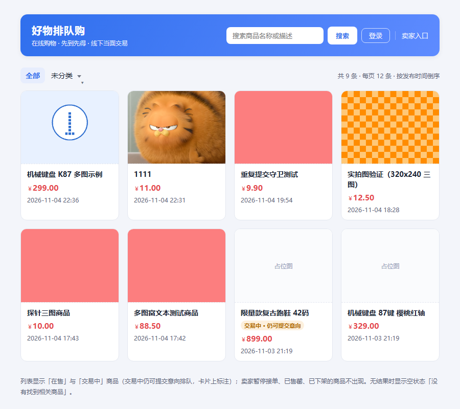

买家首页：8 张商品卡（2 行 4 列）+ 类别标签条、搜索框、登录态入口、统计文案「共 9 条 · 每页 12 条 · 按发布时间倒序」；其中两件历史商品未传图，卡片显示占位图（该条数与卡片数差 1 的原因见第五章「待后端配合」）

#### 02　买家商品详情 · 多图画廊

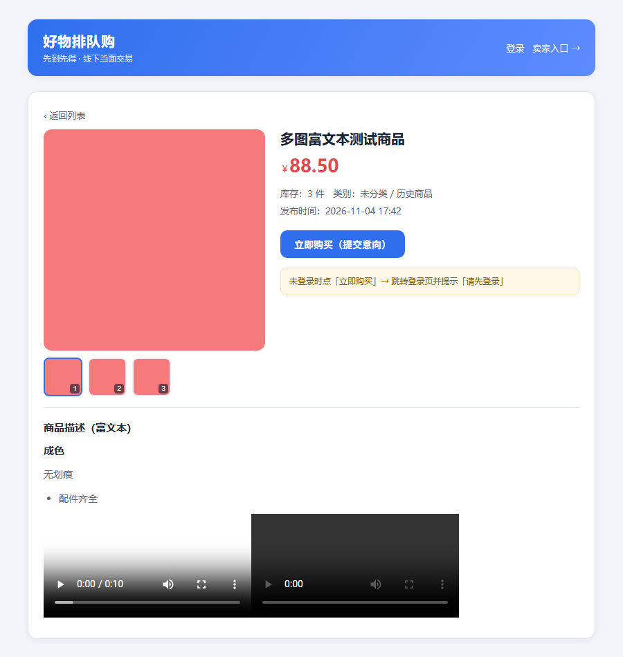

买家商品详情：主图 320×320 + 3 张缩略图（带角标与选中描边）、价格库存类别、购买按钮与未登录提示；下方富文本详情渲染出标题、列表与两个 `<video>`

#### 03　买家注册页

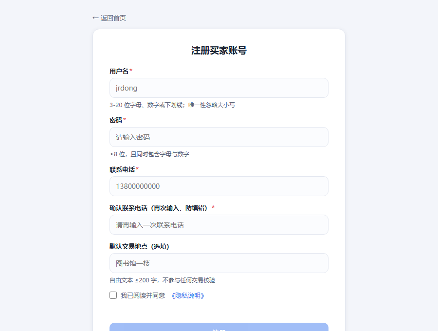

买家注册页：5 个字段 + 隐私勾选，字段下各有校验提示文案，未勾选时注册按钮置灰

#### 04　买家登录页

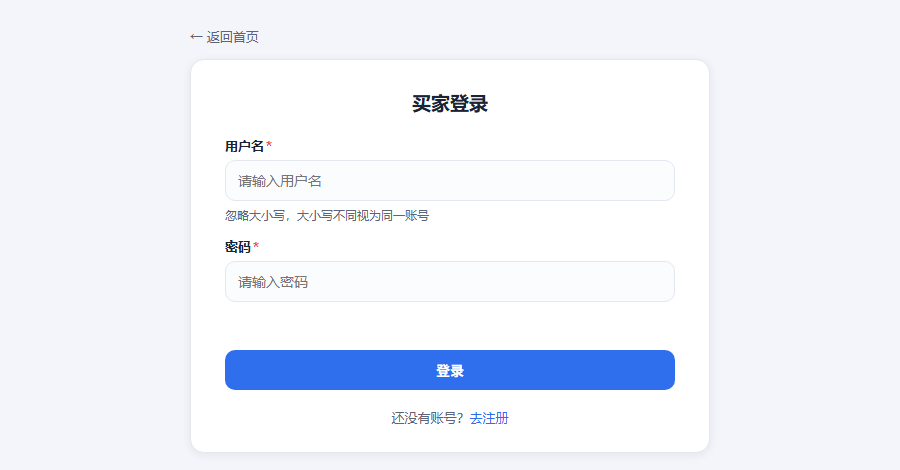

买家登录页：用户名 / 密码 / 登录按钮与「还没有账号？去注册」

#### 05　我的历史

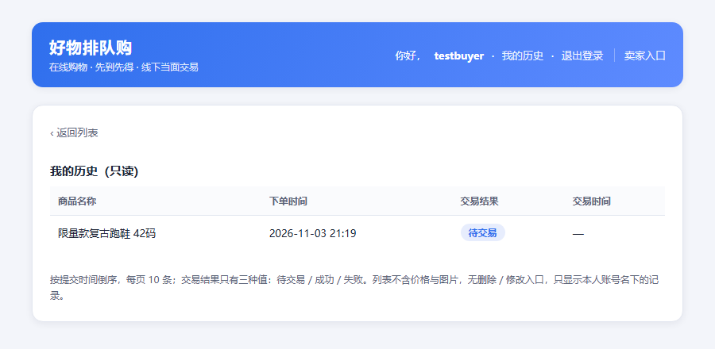

我的历史：已登录（testbuyer），只读表格四列，交易结果徽标「待交易」

### 卖家后台（06–13）

#### 06　卖家后台登录页

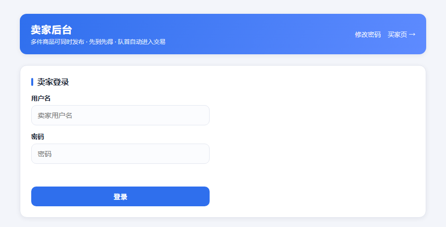

`/admin.html` 未登录时的卖家登录页（用户名 + 密码 + 登录按钮）

#### 07　卖家后台 · 商品列表

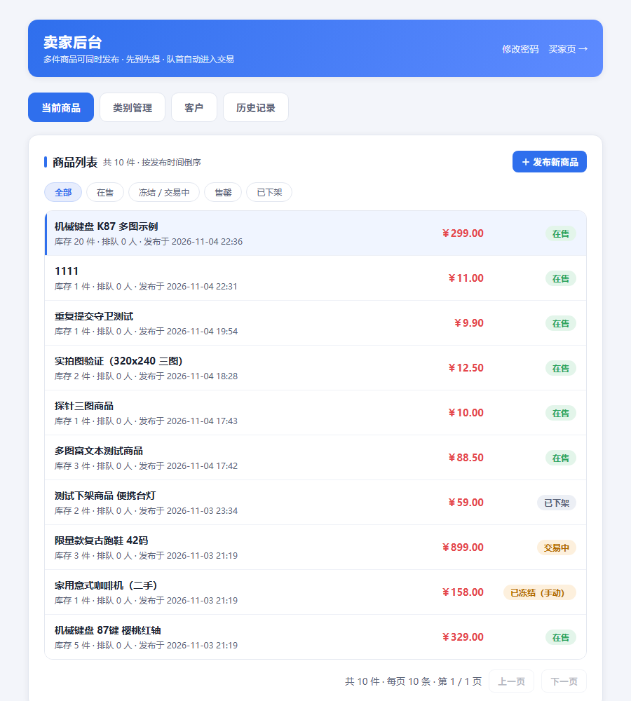

卖家后台「当前商品」：共 10 件、五个状态筛选、每行库存 / 排队人数 / 发布时间与状态徽标、选中行左侧描边、底部分页

#### 08　卖家后台 · 商品详情（8 图）

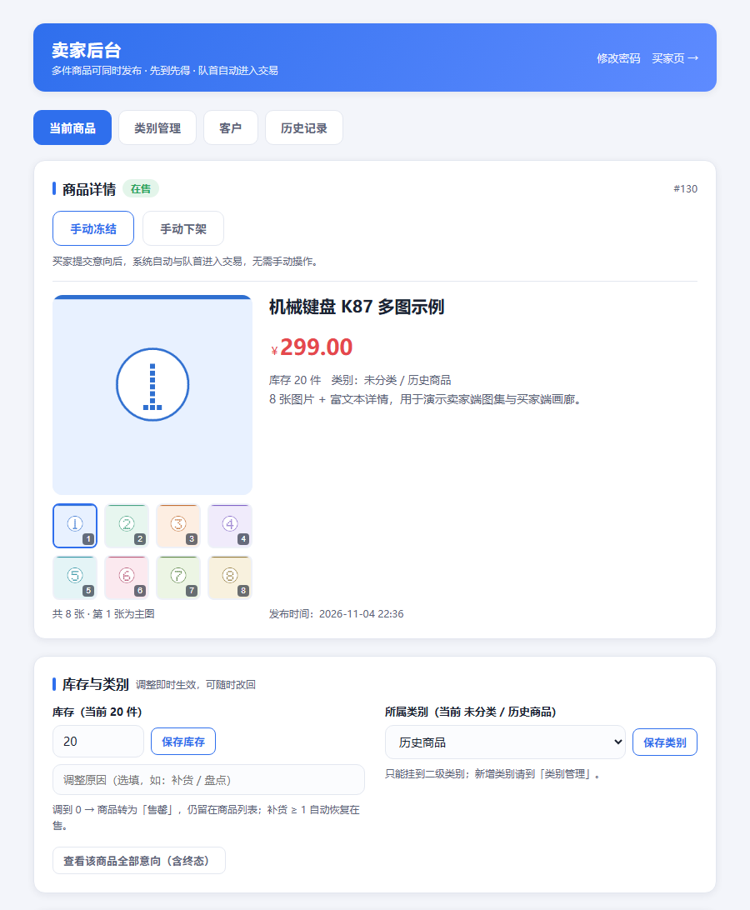

卖家后台商品详情（#130「机械键盘 K87 多图示例」）：主图 + **8 张缩略图**（4×2 网格，带序号与选中态）、「共 8 张 · 第 1 张为主图」、状态按钮、库存与类别卡片

#### 09　卖家后台 · 发布商品表单

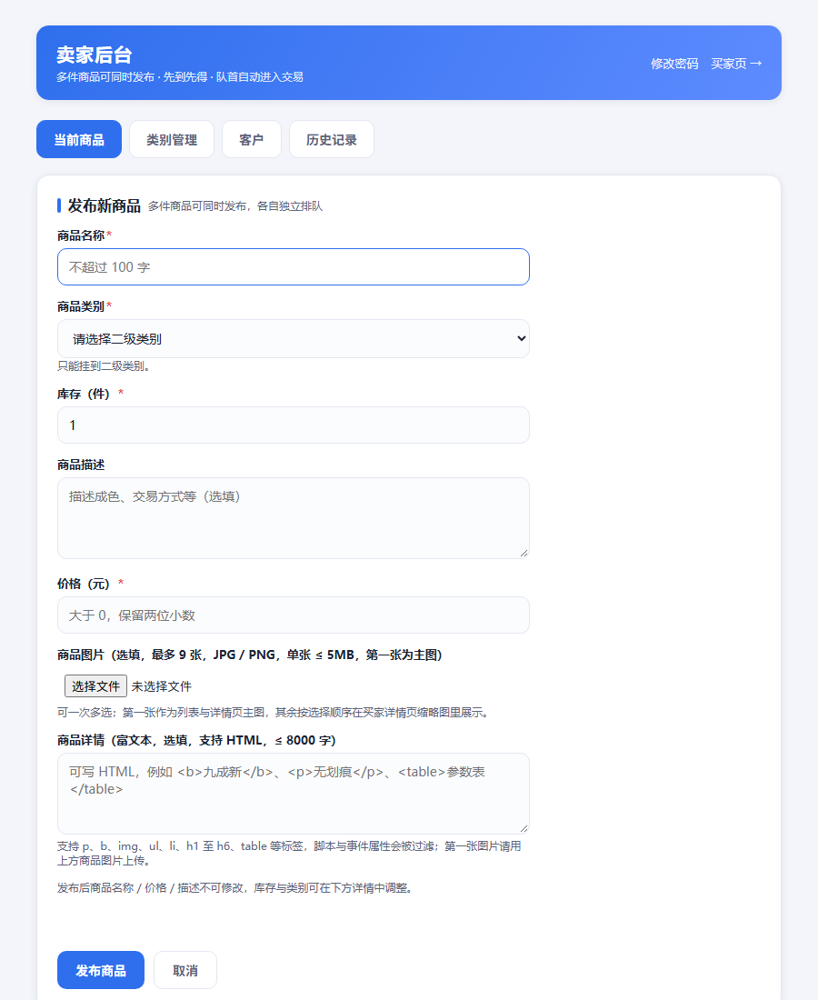

发布商品表单：「商品图片（选填，最多 9 张，JPG / PNG，单张 ≤ 5MB，第一张为主图）」与「商品详情（富文本，选填，支持 HTML，≤ 8000 字）」

#### 10　卖家后台 · 类别管理

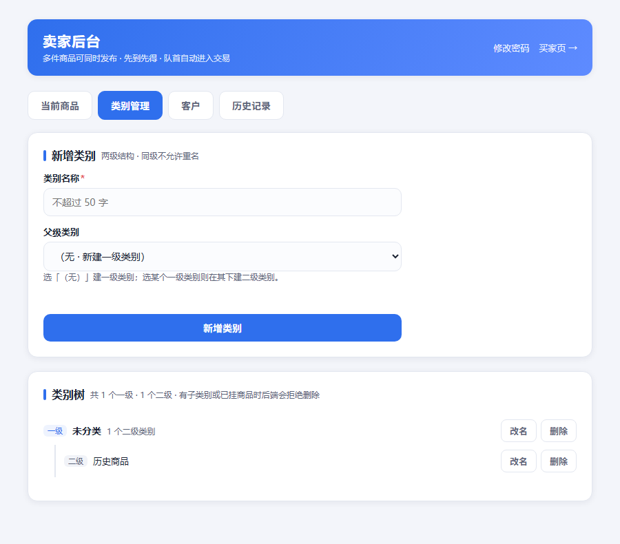

类别管理：新增类别表单（名称 + 父级下拉）与两级类别树，每个节点带「改名 / 删除」

#### 11　卖家后台 · 客户列表

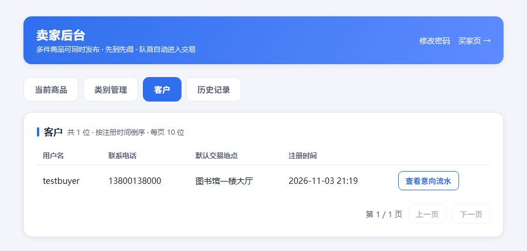

客户：用户名 / 电话 / 默认交易地点 / 注册时间 / 查看意向流水，本地分页

#### 12　卖家后台 · 历史记录

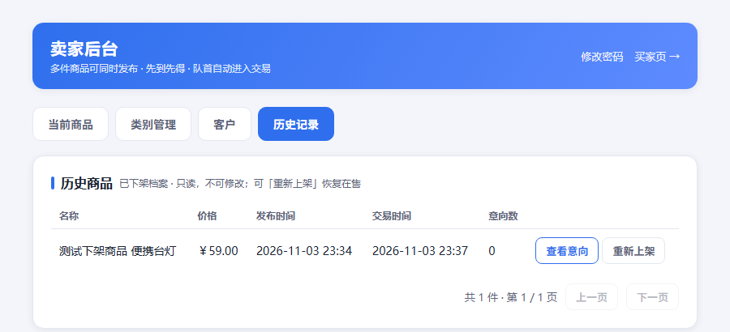

历史记录：已下架商品（便携台灯 ￥59.00）只读表格与「查看意向 / 重新上架」

#### 13　卖家后台 · 修改密码弹窗

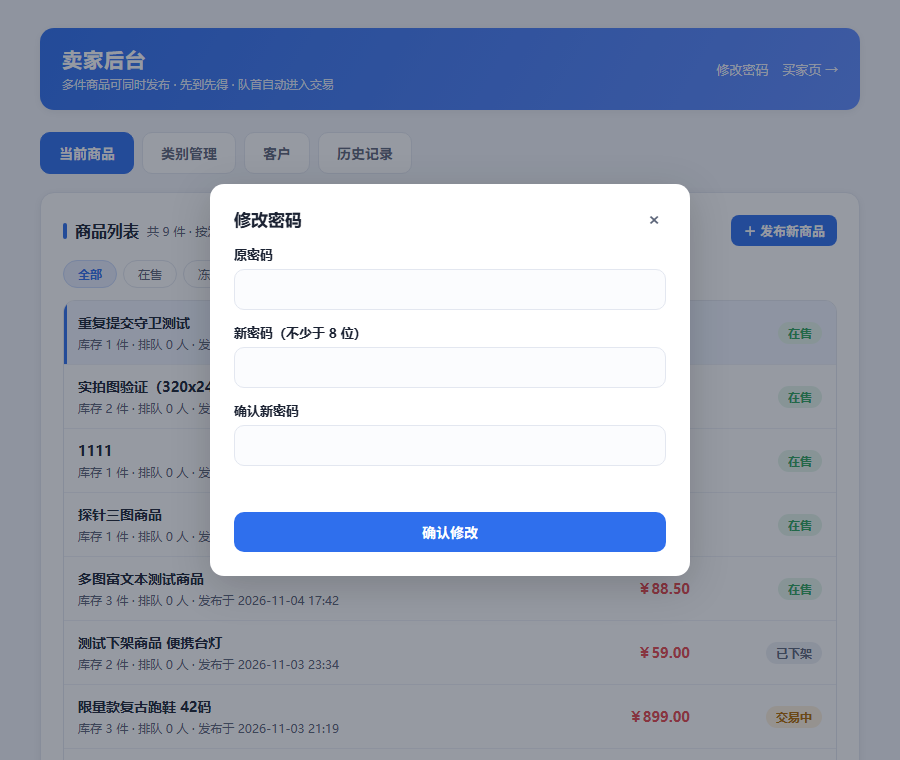

修改密码弹窗：原密码 / 新密码（不少于 8 位）/ 确认新密码

图片统一存放于 `docs/design/screenshots/iter3/`，命名规则 `NN-场景.png`；本文全部用相对路径 `screenshots/iter3/...` 引用，**截图目录要随代码一起提交**，否则仓库页里也会是空白。迭代 1 的 8 张截图仍在 `docs/design/screenshots/` 根目录，被归档页引用，未删除。

### 截图环境说明（重要）

- 截图取自本地运行的后端：`mvn spring-boot:run --server.port=8080`，浏览器为 Microsoft Edge 无头模式，视口宽 900（`style.css` 中 `.container` 上限 860），按页面实际高度裁切。
- 数据为本地 H2 文件库 `server/data/onlineshop` 的真实测试数据：卖家 `admin / seller123`，买家 `testbuyer / test1234`；商品 #33（3 图 + 富文本 + 视频）用于买家详情（02），商品 #130（8 图 + 富文本）用于卖家详情图集（08）。
- 需要登录的页面（05 / 07–13）由同源探针页先调用登录接口写入 `localStorage`，再以 iframe 打开目标页截图，因此截图里的登录态与真实登录一致，不是手工拼的静态页。
- 多图链路已实测：`#130` 用发布接口一次提交 8 张 base64 图片 → 卖家后台详情显示主图 + 8 张缩略图（4×2）、点击切换正常 → 买家详情 `product.html?id=130` 同步渲染 8 张；富文本链路已实测：`<b>` / `
` / `<ul>` / `<table>` / `<video>` 正常渲染，`<script>` 与 `onerror` 属性被丢弃；后端 `mvn test` 75 条用例全绿，含 `/uploads/**` 静态映射的 3 条。
