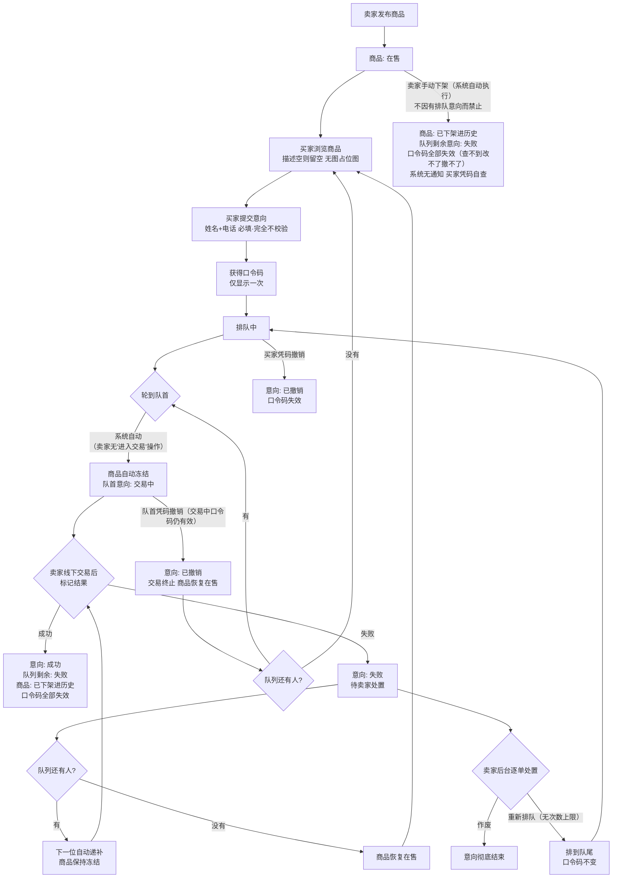
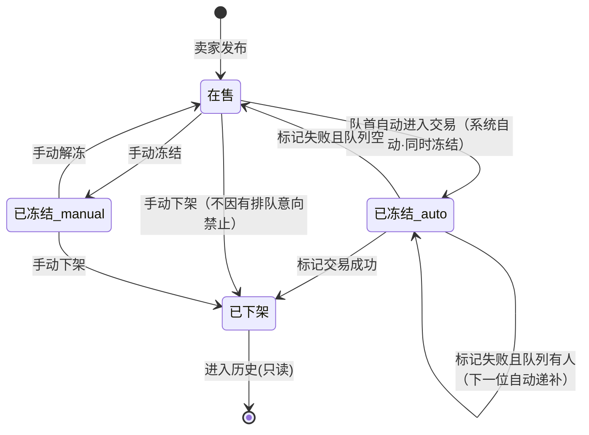
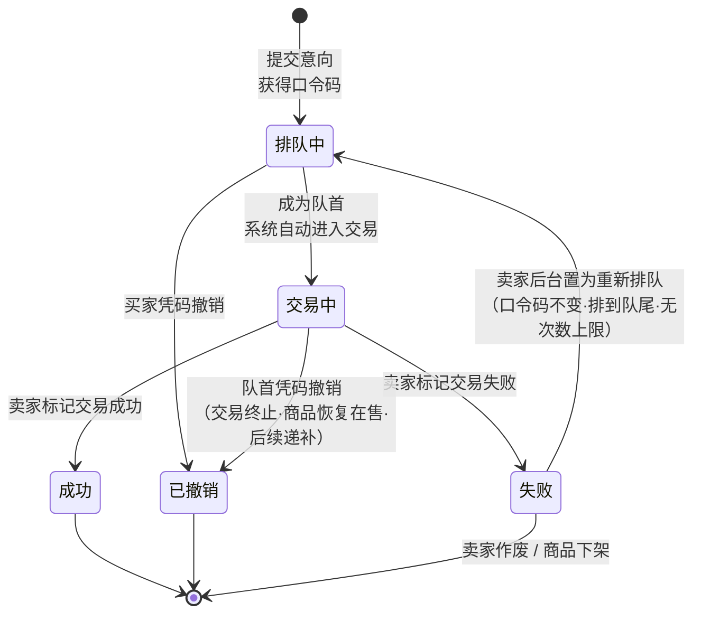

# 业务流程图

> 第 1 组 · 在线购物系统（迭代 1）　|　与 [[需求规格说明书]] 4 节状态机（v1.1）、[[用例表]] 对应
> 图为 Mermaid 源码，GitHub Wiki 页面可直接渲染。
> **2026-10-07 同步**：依据 [[需求问题库]] 第三节 8 条答复——队首**自动**进入交易并自动冻结、交易中买家**仍可撤销**、手动下架**不因有排队意向禁止**、失败意向由**卖家后台逐单处置**。

---

## 一、系统总体流程（买家排队交易全链路）

> 关键点（2026-10-07 拍板）：① 队首进入交易与冻结**均由系统自动完成**，卖家后台手动操作仅剩"标记交易结果"与"冻结/解冻"两项；② 交易中买家仍可凭码撤销，撤销后交易终止、商品恢复在售、后续队列按序递补。

## 二、商品状态机

> 说明：手动冻结与交易冻结共用"已冻结"状态，用 frozenBy 区分（manual/auto）；买家端**不区分**提示文案。无超时自动解冻机制。下架后排队意向口令码全部失效，系统无通知功能。

## 三、意向状态机

> 终态三档：**成功 / 撤销 / 失败**。口令码在进入终态后失效（重新排队期间除外）。**交易中口令码始终有效**，可查、可改、可撤。

## 四、关键规则速查

| 规则 | 内容 | 依据 |
| --- | --- | --- |
| 先到先得 | 队列按提交时间正序，卖家不能挑人 | 全站澄清 |
| 进入交易 | **系统自动**：队首自动进入交易并自动冻结，卖家后台无"进入交易"操作 | 10-07 答复 #8 |
| 冻结期间 | 不接收新意向；可浏览；不区分手动/交易文案 | 全站澄清 |
| 交易中撤销 | 买家在交易中**仍可凭码撤销**；队首撤销 → 交易终止、商品恢复在售、后续递补；撤销按钮无需隐藏 | 10-07 答复 #3 |
| 成功后果 | 商品下架进历史 + 队列剩余转失败 + 口令码全失效 + 不可撤销 | 全站澄清 |
| 失败后果 | 下一位自动递补；队列空则恢复在售 | 全站澄清 |
| 失败意向处置 | 由**卖家在后台逐单确认**作废或重新排队（非系统自动入队）；重排无次数上限、排到队尾、口令码不变 | 10-07 答复 #6、#9 |
| 手动下架 | **不因有排队意向而禁止**；队列剩余意向转失败、口令码全部失效；系统无通知功能 | 10-07 答复 #2 |
| 修改信息 | 买家改姓名/电话后，卖家后台与历史记录均显示**最新**信息，不保留改动前记录 | 10-07 答复 #4 |
| 字段校验 | 姓名/电话必填但**完全不校验**（不做 11 位数字等格式检查，填错责任在买家）；商品描述为空留空、不加默认文案，无图显示占位图 | 10-07 答复 #5、#7 |
| 口令码 | 全局唯一、只显示一次、不可找回 | 全站澄清 |
